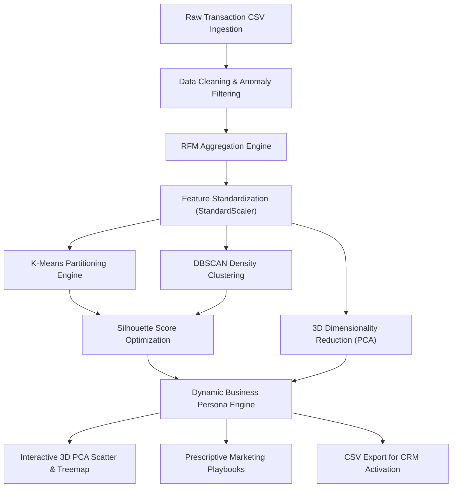

# 🎯 Customer Segmentation & Behavioral Analytics Platform

An enterprise-grade, unsupervised machine learning application built with **Python**, **Scikit-learn**, **Plotly**, and **Streamlit** to transform raw e-commerce transaction logs into mathematical customer clusters and prescriptive marketing personas.

---

## 📌 Problem Statement

In modern e-commerce and retail ecosystems, **treating all customers uniformly leads to wasted marketing budgets, high customer churn, and missed lifetime value (LTV) opportunities**. Generic promotional campaigns often fatigue high-value buyers while failing to re-engage lapsed customers.

Customer segmentation addresses this challenge by identifying heterogeneous subgroups within a customer base according to their purchasing habits. By extracting **Recency, Frequency, and Monetary (RFM)** signals and applying unsupervised clustering algorithms, businesses can:
- **Maximize Return on Ad Spend (ROAS):** Focus premium retention budgets on top-tier advocates (*Champions*).
- **Mitigate Churn Risk:** Automatically flag high-value customers showing extended purchase inactivity (*At Risk*).
- **Personalize Product Recommendations:** Target frequent low-spend buyers (*Potential Loyalists*) with upsell incentives.
- **Automate Lifecycle Marketing:** Feed algorithmic persona tags directly into CRM marketing automation pipelines (Klaviyo, HubSpot, Salesforce).

---

## 📊 Data & Provenance

The platform is designed around the standard **UCI Online Retail Dataset** schema, capturing all transactions occurring between UK-based online non-store retailers and international customers:

| Attribute | Data Type | Description | Handling & Cleaning Rules |
|---|---|---|---|
| `InvoiceNo` | `String` | 6-digit transaction identifier | Rows prefixed with `'C'` indicate cancellations and are removed. |
| `StockCode` | `String` | 5-digit distinct product identifier | Validated for product-level consistency. |
| `Description` | `String` | Product/item catalog description | Stripped and standardized. |
| `Quantity` | `Integer` | Units purchased per transaction line | Filtered for positive values (`Quantity > 0`); returns/anomalies dropped. |
| `InvoiceDate` | `Datetime` | Exact date and time of transaction | Parsed into `datetime64[ns]` format for time-delta computation. |
| `UnitPrice` | `Float` | Unit price in sterling (£) | Filtered for positive pricing (`UnitPrice > 0`). |
| `CustomerID` | `String/Int` | Unique 5-digit customer identifier | Dropped if null/missing to ensure valid account attribution. |
| `Country` | `String` | Customer country of residence | Used for regional metadata and filtering. |
| `TotalAmount` | `Float` | Derived monetary transaction value | Computed as $\text{Quantity} \times \text{UnitPrice}$ rounded to 2 decimal places. |

---

## 🏗️ System Architecture

The end-to-end data pipeline seamlessly moves data from raw ingestion to machine learning clustering, interactive 3D visualizations, and actionable marketing playbooks:



### Module Breakdown:
- **`app.py`:** Landing page and platform navigation hub.
- **`pages/1_Dashboard.py`:** File uploader, data cleaning execution, and top-level executive revenue KPIs.
- **`pages/2_RFM_Analysis.py`:** Computes customer-level RFM metrics and renders multi-panel distribution histograms.
- **`pages/3_Clustering.py`:** Interactive ML hyperparameter tuning ($k$, $\epsilon$, $\text{min\_samples}$), Silhouette Score metric, and 3D PCA scatter plot.
- **`pages/4_Segments.py`:** Persona generation, revenue Treemap, marketing playbook expanders, customer lookup, and CSV export.
- **`src/`:** Modular core libraries (`preprocessing.py`, `rfm.py`, `clustering.py`, `personas.py`, `visualization.py`).

---

## 🔬 Machine Learning Methodology

### 1. RFM Behavioral Feature Engineering
For each unique `CustomerID`, three behavioral attributes are computed:
- **Recency ($R$):** Days elapsed between customer's latest purchase and reference anchor ($\max(\text{InvoiceDate}) + 1\text{ day}$).
- **Frequency ($F$):** Total count of unique `InvoiceNo` orders placed by the customer.
- **Monetary ($M$):** Total gross revenue generated ($\sum \text{TotalAmount}$).

### 2. Feature Standardization (`StandardScaler`)
Because RFM metrics operate on vastly different scales (e.g., Recency in days $[1, 373]$, Monetary in thousands of dollars), features are standardized with zero mean and unit variance:
$$z = \frac{x - \mu}{\sigma}$$

### 3. Clustering Algorithms
- **K-Means Partitioning:** Minimizes inertia (within-cluster sum-of-squares) across $k$ centroids.
- **DBSCAN (Density-Based Spatial Clustering of Applications with Noise):** Discovers arbitrary shapes and isolates anomalous outliers ($\text{Cluster } -1$).

### 4. Cluster Quality Validation (Silhouette Analysis)
Clustering quality is evaluated using the **Silhouette Score** $s(i)$:
$$s(i) = \frac{b(i) - a(i)}{\max(a(i), b(i))}$$
where $a(i)$ is mean intra-cluster distance and $b(i)$ is mean nearest-cluster distance.

### 5. 3D Principal Component Analysis (PCA)
Projects 3D/high-dimensional feature distributions into orthogonal principal components ($PCA_1, PCA_2, PCA_3$) maximizing explained variance for intuitive 3D spatial rotation and analysis.

### 6. Behavioral Persona Mapping

| Persona | RFM Profile | Strategic Playbook |
|---|---|---|
| **Champions** | Low $R$, High $F$, High $M$ | VIP loyalty perks, early product access, brand advocacy programs. |
| **Loyal Customers** | Moderate/Low $R$, High $F$, Moderate $M$ | Upsell higher-tier products, review incentives, cross-sell related categories. |
| **Potential Loyalists** | Low $R$, Low/Moderate $F$, Moderate $M$ | Onboarding series, personalized discounts, membership incentives. |
| **At Risk** | High $R$, High $F$, High $M$ | Personalized win-back campaigns, reactivation incentives, customer surveys. |
| **Hibernating** | High $R$, Low $F$, Low $M$ | Aggressive flash discounts, re-permission campaigns, list sunsetting. |
| **Outliers** | High anomaly distance / Noise | Manual inspection for bulk wholesale accounts or anomalous orders. |

---

## 💻 Installation & Usage Instructions

### Prerequisites
- Python 3.10 or 3.11
- Git

### 1. Local Environment Setup

```bash
# Clone the repository
git clone https://github.com/your-username/customer-segmentation.git
cd customer-segmentation

# Create and activate virtual environment
python -m venv venv

# Windows
venv\Scripts\activate

# macOS / Linux
source venv/bin/activate

# Install dependencies
pip install -r requirements.txt
```

### 2. Run Automated Unit Tests

```bash
pytest tests/ -v
```

### 3. Launch Streamlit Application

```bash
streamlit run app.py
```
Open your browser at `http://localhost:8501`.

---

## 🐳 Docker Containerization

Deploy the application with Docker in a self-contained, isolated environment:

```bash
# Build Docker image
docker build -t customer-segmentation:latest .

# Run Docker container on port 8501
docker run -d -p 8501:8501 --name customer-segmentation-app customer-segmentation:latest

# Verify health status
docker ps
```
Access the application at `http://localhost:8501`.

---

## 🧪 Test Suite Structure

The test suite covers full-pipeline data integrity, edge cases, algorithms, and visualization utilities:
- `tests/test_preprocessing.py`: Validates missing customer removal, cancellations, and total amount calculation.
- `tests/test_rfm.py`: Tests RFM aggregation and quintile scoring.
- `tests/test_clustering.py`: Tests StandardScaler preprocessing, K-Means, DBSCAN, and PCA.
- `tests/test_personas.py`: Tests business persona rule mapping and outlier handling.
- `tests/test_visualization.py`: Tests Plotly subplots, 3D scatter plots, and treemap generation.
- `tests/test_segmentation.py`: Tests negative quantity handling and positive recency invariant.
